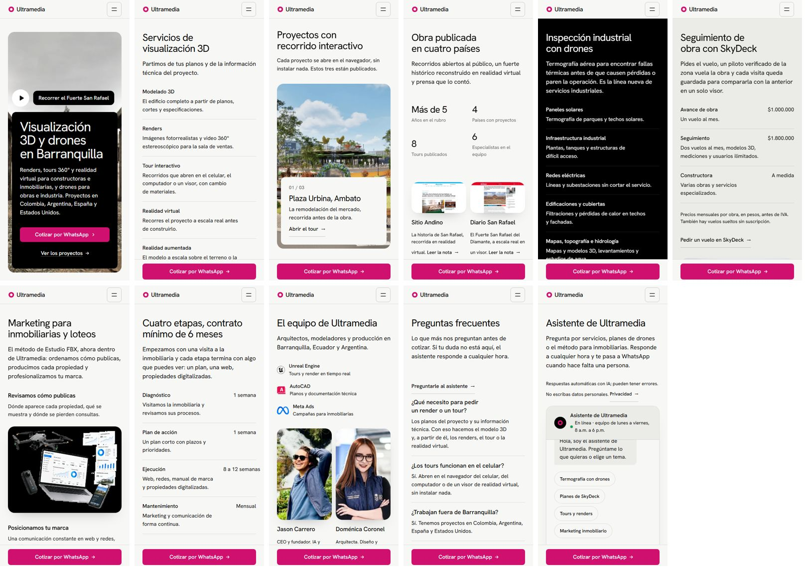
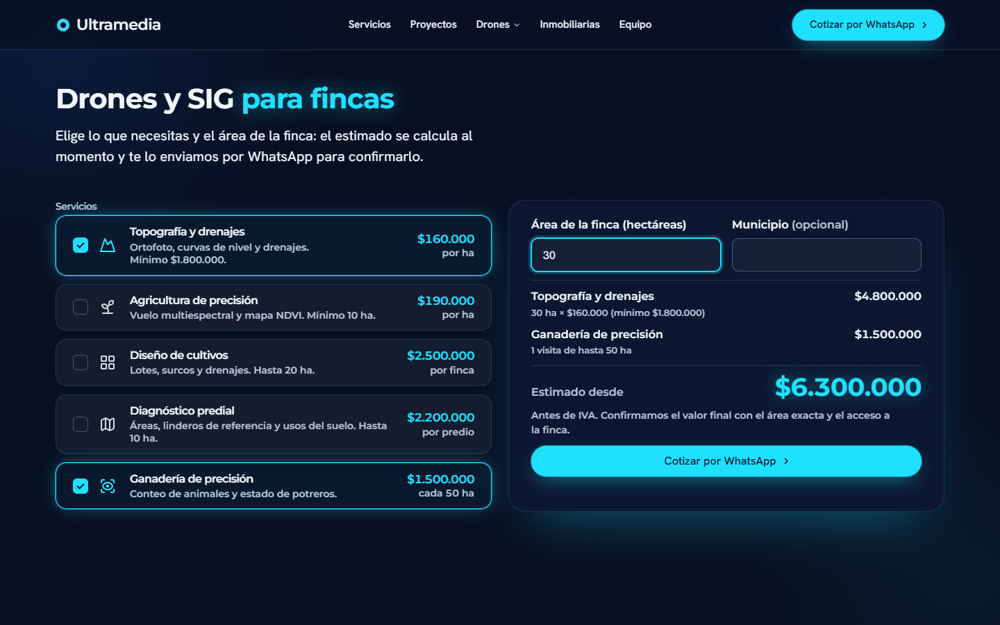
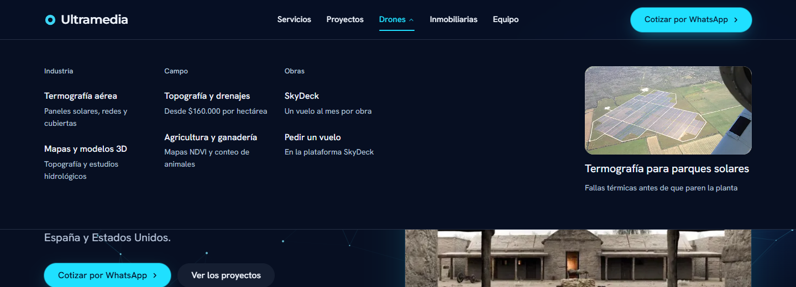
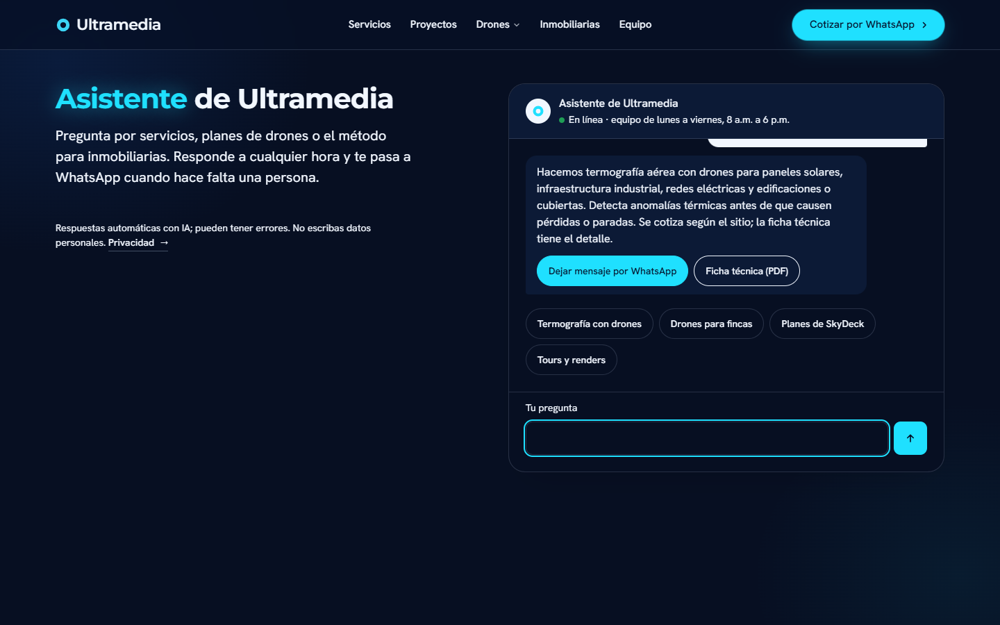
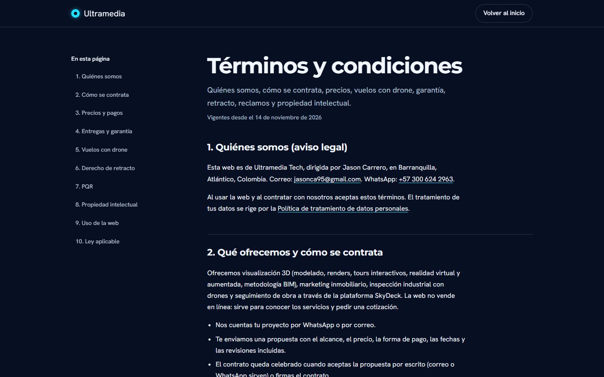

# Ultramedia: web nueva (avance para revisión)

Rebranding de ultramedia.com.co. Reúne la visualización 3D y los drones de Ultramedia con el marketing inmobiliario de
Estudio FBX, suma la línea nueva de drones industriales (termografía) y enlaza a SkyDeck para el seguimiento de obra.
Incluye un asistente de chat que responde a cualquier hora y pasa a WhatsApp.

**Ver la web en vivo: https://safetyvr360-tech.github.io/ultramedia-web/**

Estado: avance del 15 de noviembre de 2026, para recibir comentarios del cliente. El diseño sigue la línea de
neuralframe.art: fondo azul noche, títulos con una frase en cian, red de puntos animada en el inicio y tarjetas
de vidrio con íconos. El chat responde con datos guardados
mientras la web esté en GitHub Pages; con la clave de Anthropic en el hosting final responde con IA.

## Cómo se ve

### En computador


### En celular


### Cotizador para fincas


### Detalles
| Menú de drones | Asistente | Términos y condiciones |
| --- | --- | --- |
|  |  |  |

## Qué tiene la página

1. **Inicio:** visualización 3D y drones en Barranquilla, con el recorrido del Fuerte San Rafael.
2. **Servicios de visualización 3D:** modelado, renders, tours interactivos, realidad virtual y aumentada, BIM.
3. **Proyectos con recorrido:** Plaza Urbina, Casa San Martín y Box House, cada uno con su tour.
4. **Obra publicada en cuatro países:** cifras y notas de prensa del Fuerte San Rafael.
5. **Inspección industrial con drones:** termografía para paneles solares, industria, redes y cubiertas.
6. **Drones y SIG para fincas:** topografía, agricultura y ganadería de precisión, diseño de cultivos y diagnóstico predial, con un cotizador que calcula el estimado y lo envía por WhatsApp.
7. **Seguimiento de obra con SkyDeck:** planes y enlace a skydeck.dronesbaq.com.
8. **Marketing para inmobiliarias y loteos** y su **método en cuatro etapas** (Estudio FBX).
9. **Equipo**, **preguntas frecuentes** y el **asistente**.
10. Páginas legales: política de datos (Ley 1581), términos y condiciones (Ley 1480), PQR y cookies.

## Verla en tu computador

Descarga el repositorio (Code > Download ZIP), descomprímelo y, dentro de la carpeta, ejecuta:

```bash
python -m http.server 8000
```

Luego abre http://localhost:8000 en el navegador. (Abrir `index.html` con doble clic no carga las animaciones,
porque el navegador bloquea esos archivos fuera de un servidor.)

## Lo que falta

- Fotos propias de drones y termografía: las tres fotos de drones de hoy son de reemplazo (Wikimedia Commons).
- Un video corto para el inicio y el logo nuevo, si lo hay.
- Para lo legal: nombre completo y cédula o NIT del responsable, y dirección de notificaciones.
- La clave de Anthropic en el hosting para que el chat use IA (sin ella responde con datos guardados).

Más detalle técnico en [LEEME.md](LEEME.md).
